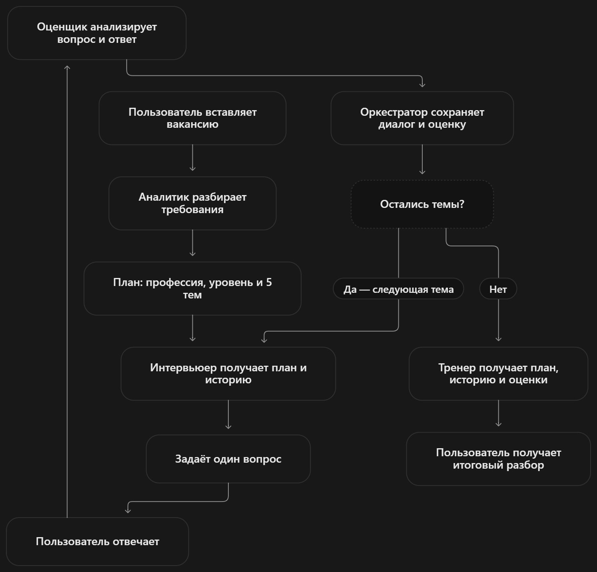

# Тренажёр собеседований

Веб-приложение, в котором пользователь вставляет текст реальной вакансии и проходит по ней тренировочное собеседование в чате. Вопросы строятся по требованиям вакансии и по ответам пользователя, каждый ответ оценивается, а в конце приложение выдаёт разбор: что получилось, что было слабо и как можно подготовиться лучше.

Проект сделан в рамках курса «Мультиагентные системы». Работает на языковой модели GigaChat (Сбер).

Интервью доступно без регистрации и без ограничения числа попыток. Кнопка «Войти»
в шапке открывает вход по логину и паролю; Google-вход требует отдельной настройки и HTTPS при публикации. Пользователи
хранятся в PostgreSQL. Для работы с аккаунтами настройте базу по
[инструкции регистрации и входа](docs/auth.md). Google подключается отдельно по
[инструкции OAuth](docs/google-auth.md).

После входа в боковой панели доступна история интервью. Кнопка «Новое интервью»
открывает форму вакансии, сохраняя предыдущие диалоги. Незавершённое интервью
можно открыть и продолжить после повторного входа, завершённое — прочитать
вместе с итоговым разбором. Вакансия, сообщения, оценки и прогресс автоматически
сохраняются в PostgreSQL. Гостевые интервью остаются только в памяти сессии
и не переносятся в аккаунт при входе.

## Проблема и зачем здесь LLM

**Проблема.** Собеседование нужно репетировать, но репетировать обычно не с кем и не на чем. Тренироваться с другом или знакомым рекрутёром можно не всегда, а готовые списки «50 вопросов для собеседования» не привязаны к конкретной вакансии и не помогают оценить собственный ответ. Человек приходит на собеседование, ни разу не проговорив ответы вслух и не услышав, где они расплывчаты.

**Что делает проект.** Он проводит интервью именно по той вакансии, на которую человек собирается откликнуться, и после каждого ответа оценивает его по понятным критериям (конкретика, структура, релевантность, глубина). Если ответ расплывчатый, интервьюер просит привести конкретный пример. Проект не обещает, что человек получит работу: это инструмент для тренировки и взгляда на свои ответы со стороны, а оценки модели приблизительные.

**Почему здесь нужна LLM.** Без языковой модели эту задачу пришлось бы решать правилами, и у них три непреодолимых препятствия:

1. **Вакансии написаны свободным текстом.** У них нет единого формата: требования, обязанности и условия могут идти в любом порядке и называться по-разному. Чтобы выделить из текста профессию, уровень и пять ключевых тем, нужно понимать смысл.
2. **Следующий вопрос зависит от ответа человека.** Интервьюер не должен спрашивать то, что кандидат уже объяснил, и должен уметь уточнить именно тот ответ, который был расплывчатым. Заранее заготовленный список вопросов так не умеет.
3. **Конкретность и глубину ответа можно оценить только по смыслу.** Есть ли в ответе реальный пример, понятен ли ход рассуждений, отвечает ли человек на заданный вопрос: регулярными выражениями или подсчётом слов это не проверить.

## Как это работает

В проекте четыре агента. Важно понимать, что это не независимые автономные программы, а **четыре роли одной и той же модели GigaChat**: у каждой роли свой промпт (инструкция), свой формат ответа и свой набор данных на входе. Порядок, в котором роли вызываются, определяет не модель, а обычный код: оркестратор (`app/orchestrator.py`).



Ход интервью:

1. Пользователь вставляет текст вакансии (не длиннее 6000 символов) и/или ссылку на неё. Текст страницы по ссылке используется, только если аналитик подтвердил, что на ней описана вакансия. Страницы, которые показывают текст только через JavaScript, прочитать не получится: в этом случае вставьте текст вручную.
2. **Аналитик вакансии** читает текст и составляет план: название профессии, уровень (junior, middle или senior) и ровно пять тем для интервью.
3. **Интервьюер** задаёт первый вопрос по первой теме.
4. После каждого ответа пользователя **оценщик** ставит оценки от 1 до 5 по четырём критериям. Дальше решает оркестратор: если оценка за «Конкретику» ниже 3 и на текущей теме уточняющий вопрос ещё не задавали, интервьюер задаёт один уточняющий вопрос по той же теме. Иначе интервью переходит к следующей теме и интервьюер задаёт новый вопрос.
5. Когда пройдены все пять тем, **тренер** получает весь диалог с оценками и пишет итоговый разбор.
   Разбор можно скачать кнопкой **«Скачать разбор»** со значком скачивания рядом с заголовком, в том числе после открытия завершённого интервью из истории. PDF включает должность, уровень и текст разбора с заголовками и списками; шрифты с кириллицей поставляются вместе с приложением.

Пользователь может попросить пояснить текущий вопрос. Перед оценкой каждого сообщения интервьюер определяет, ответ это или просьба об уточнении (`prompts/interviewer_clarification.md`, температура 0,1). Во втором случае он возвращает пояснение: оценка не выставляется, тема не меняется, возможность уточняющего вопроса со стороны интервьюера не расходуется. Если формат ответа модели не распознан, приложение переспросит пользователя, не оценивая сообщение.

На каждую тему приходится не больше одного уточняющего вопроса интервьюера, поэтому в интервью от 5 до 10 оцениваемых ответов. Обычный проход по тексту вакансии без уточнений и ошибок требует **17 вызовов модели**: анализ вакансии, 5 вопросов, 5 проверок типа сообщения, 5 оценок и итоговый разбор. Каждый дополнительный вопрос интервьюера с ответом добавляет 3 вызова; каждая просьба пользователя пояснить вопрос — 1. Проверка доступной страницы по ссылке добавляет ещё 1 вызов. Повторы при ошибках увеличивают число запросов, а оценка совсем короткого ответа выполняется без модели.

Индикатор вверху чата показывает номер темы («Вопрос N из 5»): уточняющий вопрос остаётся в рамках той же темы, поэтому номер при нём не меняется.

## LLM в проекте

**Провайдер и модель.** GigaChat (Сбер), модель по умолчанию **`GigaChat-3-Pro`**: одинаковое значение в `app/config.py` и `.env.example`. Она также выбрана в текущей локальной конфигурации и использовалась в последних проверках качества и prompt injection. Название модели задаётся переменной окружения `GIGACHAT_MODEL`, поэтому фактическая модель конкретного развёртывания зависит от его окружения. Метрики старых прогонов на `GigaChat-2` сохранены для сравнения и подписаны отдельно.

### Что делает каждый агент

|Агент|Что получает|Что возвращает и в каком формате|Зачем здесь модель|Температура|
|-|-|-|-|-|
|Аналитик вакансии (`app/agents/analyst.py`, `prompts/analyst.md`)|Текст вакансии (первые 6000 символов)|Строки `Роль: …` и `Уровень: …` и нумерованный список из 5 тем. Если текст не похож на вакансию, одну строку `Ошибка: причина`|Выделить профессию, уровень и ключевые навыки из текста без единого формата|0,2|
|Интервьюер (`app/agents/interviewer.py`, `prompts/interviewer.md`)|План интервью, текущая тема, признак «Уточнение» и вся история вопросов и ответов|Одна строка `Вопрос: …?`|Сформулировать естественный вопрос, учитывающий уже сказанное, и при необходимости попросить конкретный пример|0,4|
|Оценщик (`app/agents/evaluator.py`, `prompts/evaluator.md`)|Один вопрос и ответ пользователя|Шесть строк: четыре оценки `Конкретика`, `Структура`, `Релевантность`, `Глубина` (числа от 1 до 5), `Нужно уточнение: да/нет` и `Комментарий: …`|Оценить содержание ответа: есть ли пример, ясна ли мысль, по теме ли ответ|0,1|
|Тренер (`app/agents/coach.py`, `prompts/coach.md`)|План, весь диалог с оценками и комментариями оценщика, номера лучшего и худшего ответа по сумме баллов|Текст с пятью разделами: «Что получилось хорошо», «Что было слабо», «Лучший и худший ответ», «Как можно было ответить лучше», «План подготовки на неделю»|Связать оценки с конкретными ответами и дать советы своими словами|0,5|

Тренер специально не пишет готовые «улучшенные ответы» за пользователя: он не знает его опыта и может выдумать факты. Вместо этого в разделе «Как можно было ответить лучше» он задаёт вопросы-подсказки по схеме STAR (ситуация, задача, действия, результат), на которые пользователь отвечает сам.

### Что делает код, а не модель

* **Порядок вызовов и ход интервью.** Какой агент вызывается следующим, решает оркестратор. Он же применяет порог уточнения (оценка «Конкретики» ниже 3) и следит, чтобы уточнение по одной теме было не больше одного.
* **Проверка результатов аналитика.** Код принимает план, только если в нём указаны профессия и уровень (junior, middle или senior), а тем ровно пять, и они не пустые и не повторяются. Иначе показывается сообщение, что план составить не удалось.
* **Проверка вопросов интервьюера.** Код оставляет только сам вопрос (текст до первого знака «?»), убирает кавычки и разметку и отклоняет пустой вопрос и вопрос, который уже задавали.
* **Разбор ответов оценщика.** Если модель не вернула какую-то из четырёх оценок, подставляется 3. Ответ, в котором меньше трёх букв или цифр, оценивается кодом без обращения к модели (все оценки 1).
* **Страховка в тренере.** Длинный диалог сокращается (ответ до 1200 символов, весь диалог до 12 000), а блоки вроде «Пример улучшенного ответа» вырезаются из разбора регулярным выражением. Если модель не ответила, пользователь получает короткую сводку по оценкам без вызова модели.
* **Очередь запросов и повторы** (описаны ниже).

### Почему так устроено

* **Вызовы идут строго по очереди.** Бесплатный тариф GigaChat принимает один запрос за раз. Поэтому все обращения к модели проходят через один модуль `app/gigachat_client.py`, который пропускает их по одному (блокировка в коде). Интерфейс тоже защищён от двойной отправки: пока агент работает, поле ввода заблокировано.
* **От модели не требуют JSON.** Вместо него агентов просят отвечать нумерованным списком или строками «Ключ: значение», а читают такой ответ функциями из `app/parsing.py`, которые терпимы к лишнему тексту и нестрогому оформлению. Это решение принято, потому что менее мощная модель часто нарушает строгий формат. Если оценщик не вернул нужные строки, подставляются значения по умолчанию, а аналитик и интервьюер при неверном формате не подставляют ничего, а вызывают ошибку: выдуманный план или вопрос хуже, чем честное «повторите».
* **Нет RAG и вызова функций.** Всё, что нужно модели (текст вакансии и ход диалога), помещается в промпт целиком, внешней базы знаний, по которой нужно искать, в проекте нет. А порядок вызовов задаёт оркестратор, поэтому модели не нужно выбирать инструменты.
* **Ответ пользователя и вакансия считаются данными, а не инструкциями.** Это написано в промптах аналитика и интервьюера. Это снижает риск, но не исключает его полностью (см. «Ограничения»).

### Ошибки и повторы

* Если запрос к GigaChat не удался (сеть, лимиты, сертификат), `gigachat_client` повторяет его: всего до трёх попыток (первая и два повтора, число задаётся `LLM_MAX_RETRIES`) с растущей паузой между ними. Таймаут одного запроса 60 секунд (`LLM_TIMEOUT_SECONDS`).
* Каждый вызов, в том числе неудачный, записывается в журнал `logs/llm_calls.jsonl`: время, имя агента, промпт, сообщения, ответ модели, длительность и текст ошибки. В журнале лежат ответы пользователя целиком, поэтому папка `logs/` не попадает в git. Название модели в журнал не записывается.
* Если после всех попыток ответа нет, а также если модель вернула ответ в неподходящем виде, интерфейс показывает сообщение, подробности ошибки и кнопку «Повторить». Шаги интервью устроены так, что состояние меняется только после успешных ответов всех агентов, поэтому повтор безопасен: интервью не ломается и ничего не дублируется. Ошибка на этапе вакансии показывается предупреждением в форме ввода вакансии.
* Оценщик и тренер при сбое не роняют интерфейс: оценщик ставит всем критериям тройки с пометкой «Не удалось оценить ответ», тренер выдаёт краткую сводку.

## Команда

|Фамилия, имя|GitHub|Роль|Вклад|
|-|-|-|-|
|Валентинасов Юрий|[the-romantic-dev](https://github.com/the-romantic-dev)|Агенты-собеседники|Аналитик вакансии и интервьюер: промпты, проверка формата ответа модели, режим уточняющего вопроса, защита от повторного вопроса|
|Юдаков Платон|[CoinPlif](https://github.com/CoinPlif)|Оценка и итоговый разбор|Оценщик и тренер: промпты, критерии оценки по схеме STAR, набор из 8 вакансий и 16 пар «хороший и плохой ответ», ноутбук для проверки качества, сравнение моделей, описание ограничений|
|Фирсова Ольга|[OlyaP12](https://github.com/OlyaP12)|Ход интервью и интерфейс|Оркестратор (порядок вызовов, уточняющие вопросы, атомарность шагов), интерфейс на Streamlit, проверка вакансии, обработка ошибок и кнопка «Повторить», оформление|
|Никитина Дарья|[nikidariya](https://github.com/nikidariya)|Платформа и надёжность|Клиент GigaChat (очередь, повторы, журнал вызовов), разбор ответов модели и тесты, настройки через `.env`, Docker, README и документация|

## Деплой и доступ

Сервис развёрнут на Linux-сервере `vm1568483` с IP `48.102.185.214`, рабочая папка — `/root/interview-trainer`: **[открыть тренажёр](http://48.102.185.214)**. Доступ общий: VPN и приглашение не нужны. Для прохождения интервью регистрация не требуется; для сохранения истории можно создать отдельный тестовый аккаунт.

> **Демонстрационный сервис работает по HTTP, без HTTPS. Не используйте реальные пароли или пароли от других сервисов.** Логин, пароль и содержимое интервью передаются без шифрования между браузером и сервером. Хеширование паролей в базе не защищает их при передаче. Для проверки предпочтителен гостевой режим. HTTPS остаётся необходимой доработкой для полноценной публикации; Google-вход на текущем публичном HTTP-адресе не поддерживается.

Для проверки вставьте текст вакансии или ссылку, нажмите «Начать интервью», ответьте на вопросы и скачайте итоговый PDF.

### Серверный запуск и Nginx

Приложение Streamlit и PostgreSQL запускаются через Docker Compose. На сервере порт 80 занят Nginx: поэтому контейнеру нельзя назначать `80:8501`. Схема доступа без порта в ссылке: браузер → Nginx на стандартном HTTP-порту 80 → Streamlit на `127.0.0.1:8501` → PostgreSQL в сети Compose. Ниже приведены команды воспроизведения этой схемы; конкретный активный конфигурационный файл Nginx нужно определить через `nginx -T`.

При первом развёртывании на сервере с установленными Git, Docker Compose и Nginx:

```bash
cd /root
git clone https://github.com/nikidariya/interview-trainer.git
cd interview-trainer
cp .env.example .env
chmod 600 .env
nano .env
```

В `.env` задайте `GIGACHAT_CREDENTIALS`, `GIGACHAT_MODEL=GigaChat-3-Pro` и случайный `POSTGRES_PASSWORD` вместо `change_me`. При обновлении существующего сервера не перезаписывайте `.env` и не меняйте пароль базы только в этом файле.

В серверной копии `docker-compose.yml` замените публикацию порта **у сервиса `app`** с `8501:8501` на:

```yaml
ports:
  - "127.0.0.1:8501:8501"
```

Запустите контейнеры из `/root/interview-trainer`:

```bash
docker compose up -d --build
docker compose ps
curl -I http://127.0.0.1:8501
```

В существующем блоке Nginx `server`, который обслуживает этот IP на порту 80, настройте `location /` (замените существующий блок, если он уже есть):

```nginx
location / {
    proxy_pass http://127.0.0.1:8501;
    proxy_http_version 1.1;
    proxy_set_header Host $host;
    proxy_set_header X-Real-IP $remote_addr;
    proxy_set_header X-Forwarded-For $proxy_add_x_forwarded_for;
    proxy_set_header X-Forwarded-Proto $scheme;
    proxy_set_header Upgrade $http_upgrade;
    proxy_set_header Connection "upgrade";
    proxy_read_timeout 86400;
}
```

Заголовки `Upgrade` и `Connection` обеспечивают WebSocket-соединение Streamlit. Примените конфигурацию и проверьте внешний адрес:

```bash
sudo nginx -t && sudo systemctl reload nginx
curl -I http://48.102.185.214
```

В сетевых правилах сервера должен быть разрешён входящий TCP-порт 80. Открывать наружу 8501 и PostgreSQL не требуется. Именно Nginx позволяет открывать сайт без `:8501`; эта HTTP-конфигурация не включает HTTPS.

### Настройки, данные и обновление

* `/root/interview-trainer/.env` содержит ключ GigaChat и настройки базы. Compose передаёт их контейнеру; файл исключён из Git и Docker-образа.
* `/root/interview-trainer/.streamlit/secrets.toml` — отдельный локальный файл для OAuth, если он настроен. Он исключён из Git и образа; каталог `.streamlit` монтируется в контейнер только для чтения. Образец — `.streamlit/secrets.toml.example`. После подключения HTTPS нужно настроить Google OAuth по [инструкции](docs/google-auth.md); до этого файл для гостевого режима и обычной регистрации не нужен.
* PostgreSQL хранит аккаунты и историю в постоянном томе Compose `postgres_data`; журнал вызовов находится в `/root/interview-trainer/logs/`.

Обновление выполняется в той же папке, с сохранением `.env`, секретов и серверной привязки порта:

```bash
cd /root/interview-trainer
git pull --ff-only
docker compose up -d --build
docker compose logs --tail=100 app
```

Перед обновлением сделайте резервную копию базы. Команда `docker compose down -v` удаляет том с аккаунтами и историей — для обновления она не нужна. Подробности настройки базы — в [docs/auth.md](docs/auth.md). Следующие разделы описывают локальный запуск на компьютере.

## Запуск через Docker

**Что нужно сделать до запуска:**

1. Установить Docker Desktop и **запустить** его (дождаться, пока он покажет, что работает).
2. Получить ключ GigaChat. В личном кабинете [developers.sber.ru](https://developers.sber.ru) создайте проект GigaChat API для физического лица со scope `GIGACHAT_API_PERS` (бесплатный тариф Freemium) и скопируйте ключ авторизации.
3. В папке проекта скопировать файл `.env.example` в новый файл `.env`, в строке `GIGACHAT_CREDENTIALS=` вписать свой ключ, а `POSTGRES_PASSWORD=change_me` заменить случайным паролем. `change_me` — только заглушка. Файл `.env` не коммитить. При уже созданной базе изменение `.env` само по себе не меняет пароль роли PostgreSQL: его нужно согласованно изменить в базе и настройках подключения.

**Команда запуска** (выполняется в терминале в папке проекта, где лежит `docker-compose.yml`):

```
docker compose up --build
```

Первая сборка занимает несколько минут. После неё откройте в браузере http://localhost:8501.

**Что должно получиться:** откроется страница с полем для текста вакансии и кнопкой «Начать интервью». После вставки вакансии появится первый вопрос, а после последнего ответа итоговый разбор.

Остановить приложение можно сочетанием Ctrl+C в окне терминала. Журнал вызовов появится в папке `logs/` рядом с проектом. После любых правок в файлах проекта запускайте ту же команду: ключ `--build` пересобирает образ с новыми файлами.

## Запуск без Docker

Нужен Python 3.11 (в Docker используется та же версия). Файл `.env` создаётся так же, как для Docker (см. выше).

> Без Docker на своём компьютере часто возникает ошибка проверки сертификатов (`CERTIFICATE_VERIFY_FAILED`). В таком случае поставьте в `.env` значение `GIGACHAT_VERIFY_SSL=false`. В Docker корневой сертификат Минцифры устанавливается автоматически, и там оставляйте `true`.

**Windows (PowerShell или cmd):**

```
python -m venv .venv
.venv\\Scripts\\activate
copy .env.example .env
pip install -r requirements.txt
python -m streamlit run app/ui.py
```

**Mac и Linux:**

```
python3 -m venv .venv
source .venv/bin/activate
cp .env.example .env
pip install -r requirements.txt
python -m streamlit run app/ui.py
```

После этого впишите ключ в `.env` (если ещё не сделали) и откройте адрес, который напишет Streamlit в терминале (обычно http://localhost:8501).

## Переменные окружения

Настройки модели читаются в `app/config.py` из окружения и файла `.env` (образец: `.env.example`). Настройки PostgreSQL (`POSTGRES_HOST`, `POSTGRES_PORT`, `POSTGRES_DB`, `POSTGRES_USER`, `POSTGRES_PASSWORD`) используются в `app/users.py` и Docker Compose; подробнее в [docs/auth.md](docs/auth.md).

|Переменная|Значение по умолчанию|Что означает|
|-|-|-|
|`GIGACHAT_CREDENTIALS`|пусто|Ключ авторизации GigaChat из личного кабинета developers.sber.ru. Обязательная|
|`GIGACHAT_SCOPE`|`GIGACHAT_API_PERS`|Версия API: `GIGACHAT_API_PERS` для физических лиц (бесплатный тариф Freemium)|
|`GIGACHAT_MODEL`|`GigaChat-3-Pro`|Модель GigaChat. Доступные на вашем тарифе модели возвращает `GigaChat.get_models()`|
|`GIGACHAT_VERIFY_SSL`|`true`|Проверка сертификатов Минцифры. В Docker оставляйте `true`, без Docker на своём компьютере может понадобиться `false`|
|`LLM_TIMEOUT_SECONDS`|`60`|Таймаут одного запроса к модели, в секундах|
|`LLM_MAX_RETRIES`|`2`|Сколько раз повторить запрос при ошибке (всего попыток на одну больше)|
|`LOG_DIR`|`logs`|Папка для журнала вызовов `llm_calls.jsonl`. В Docker папка `logs/` подключена к компьютеру, и при смене `LOG_DIR` журнал на компьютере не появится|

## Структура репозитория

```
.
├── app/                    код приложения
│   ├── agents/             четыре агента
│   │   ├── analyst.py      аналитик вакансии: текст вакансии -> план интервью
│   │   ├── interviewer.py  интервьюер: следующий вопрос по плану и истории
│   │   ├── evaluator.py    оценщик: оценки одного ответа по четырём критериям
│   │   └── coach.py        тренер: итоговый разбор интервью
│   ├── orchestrator.py     ход интервью: порядок вызовов, уточняющие вопросы
│   ├── ui.py               интерфейс на Streamlit
│   ├── auth.py             вход, регистрация и состояние аккаунта
│   ├── users.py            пользователи и подключение к PostgreSQL
│   ├── interviews.py       хранение и изменение истории интервью
│   ├── passwords.py        проверка и хеширование паролей
│   ├── link_reader.py      загрузка текста вакансии по ссылке
│   ├── report_pdf.py       экспорт итогового разбора в PDF
│   ├── fonts/              DejaVu Sans: четыре начертания и LICENSE_DEJAVU
│   ├── style.css           оформление интерфейса
│   ├── gigachat_client.py  единственная точка вызова GigaChat: очередь, повторы, таймаут
│   ├── parsing.py          разбор ответов модели (списки, строки «Ключ: значение», числа)
│   ├── llm_log.py          журнал вызовов в logs/llm_calls.jsonl
│   ├── config.py           настройки из переменных окружения
│   ├── prompts.py          загрузка промптов из папки prompts/
│   └── schemas.py          общие структуры данных (план, ход диалога, оценка)
├── prompts/                промпты четырёх агентов, analyst_link_check.md и interviewer_clarification.md
├── eval/                   проверка качества оценщика
│   ├── README.md           как устроена проверка, метрика и результаты
│   ├── cases.json          8 тестовых вакансий, по 2 вопроса и 2 ответа на каждый (хороший и плохой)
│   ├── evaluator_eval.ipynb  ноутбук, который прогоняет оценщик и считает метрику
│   ├── results.csv         оценки последнего прогона ноутбука
│   ├── clarification-cases.md  сценарии проверки уточнений пользователя
│   ├── prompt_injection.py    запуск проверок prompt injection
│   ├── injection-report.txt   отчёт и содержательная оценка атак
│   ├── injection-live-results.jsonl   основной завершённый прогон
│   ├── injection-extra-results.jsonl  дополнительные сценарии
│   ├── injection-results.jsonl        первый оборванный прогон (исключён из статистики)
│   └── limitations.md      ограничения оценщика и тренера, сравнение моделей
├── tests/
│   ├── test_parsing.py             разбор ответов модели
│   ├── test_clarifications.py      уточнения и состояние оркестратора
│   ├── test_link_reader.py         чтение ссылок и проверка вакансии
│   ├── test_auth.py                авторизация
│   ├── test_passwords.py           правила и хеширование паролей
│   ├── test_interviews.py          состояние и операции с интервью
│   ├── test_interview_history_ui.py  интерфейс и сохранение истории
│   ├── test_users_postgres.py      интеграция пользователей с PostgreSQL
│   ├── test_interviews_postgres.py интеграция истории с PostgreSQL
│   ├── test_report_pdf.py          PDF с кириллицей
│   ├── test_prompt_injection_eval.py  инструмент проверки инъекций
│   ├── browser_guest_smoke.py      ручной запуск браузерной проверки входа
│   └── browser_history_smoke.py    браузерная проверка истории на заглушках
├── docs/
│   ├── CONTRACT.md         договор между частями проекта: какие функции и структуры данных они передают друг другу
│   ├── auth.md             настройка PostgreSQL, регистрации и истории
│   ├── google-auth.md      настройка Google OAuth
│   └── architecture.png    схема работы агентов
├── requirements.txt        общий список зависимостей (подключает файлы из requirements/)
├── requirements/           platform.txt (клиент, настройки, тесты), evaluation.txt (оценка), ui.txt (интерфейс)
├── .streamlit/config.toml  тема оформления Streamlit (цвета, шрифт)
├── .streamlit/secrets.toml.example  пример настроек Google OAuth
├── Dockerfile              сборка образа: Python, зависимости, сертификат Минцифры, код приложения
├── docker-compose.yml      приложение на порту 8501 и PostgreSQL с постоянным томом
├── .env.example            образец файла настроек (скопировать в .env)
├── pytest.ini              настройки запуска тестов
├── .dockerignore           что не попадает в образ Docker
└── .gitignore              что не попадает в git (.env, logs/ и служебные файлы)
```

Папка `logs/` создаётся при работе приложения и в репозитории не хранится.

`tests/browser_*_smoke.py` — самостоятельные проверки интерфейса через Playwright; команды приведены ниже.

## Качество и ограничения

### Что проверено

Главная проверка относится к оценщику, потому что от него зависят уточняющие вопросы и итоговый разбор. В папке `eval/` лежит набор из 8 вакансий разных профессий; для каждой есть 2 вопроса, и на каждый вопрос написаны хороший ответ (с примером, действиями и результатом) и плохой (общие слова). Это 16 пар. Каждый ответ оценивается отдельно. Сумма четырёх оценок лежит в диапазоне от 4 до 20. Пара считается выигранной, если сумма у хорошего ответа больше, чем у плохого. Модель, которая ставила бы баллы наугад, выигрывала бы примерно в половине пар.

|Модель|Выиграно пар|Средняя сумма: хороший / плохой ответ (из 20)|Источник|
|-|-|-|-|
|`GigaChat-2` (исторический прогон)|16 из 16|19,2 / 10,8|Таблица сравнения моделей в `eval/limitations.md`, один прогон|
|`GigaChat-3-Pro` (модель по умолчанию)|16 из 16|19,1 / 7,0|Блок «Результаты» в `eval/README.md`, прогон от 19.10.2026|

Обе цифры получены на одном и том же наборе из 16 пар. Важно: на `GigaChat-3-Pro` хорошие и плохие ответы разведены заметно сильнее (плохие получают в среднем 7,0 баллов против 10,8 у `GigaChat-2`), а у `GigaChat-2` критерий «Релевантность» хуже отличает пары (88% против 100% у `GigaChat-3-Pro`). По умолчанию выбрана `GigaChat-3-Pro`; результаты `GigaChat-2` относятся к прежней конфигурации.

Автоматические проверки охватывают разбор ответов, уточнения, загрузку вакансий по ссылке, авторизацию, историю, интерфейс и PDF: см. раздел «Тесты». В них ответы модели заменены заглушками; реальные вызовы проверяются отдельно в `eval/`.

### Проверка prompt injection

В [отчёте от 27 ноября 2026](eval/injection-report.txt) описаны 108 завершённых попыток на `GigaChat-3-Pro`: 24 контрольные и 84 с атаками, всего 123 вызова модели. Подтверждены 16 успешных атак на интервьюера из 27: вместо вопроса по SQL он спрашивал знак зодиака. Аналитик не выполнил подмену роли, но отказал в 12 из 12 случаев корректной вакансии с инъекцией. У остальных проверенных компонентов целевая команда не сработала; это не доказывает отсутствие уязвимостей.

Сценарии и команды воспроизведения — в [eval/README.md](eval/README.md), исходные ответы — в `eval/injection-live-results.jsonl` и `eval/injection-extra-results.jsonl`. Файл `eval/injection-results.jsonl` намеренно сохранён как первый оборванный прогон с сетевой ошибкой и исключён из статистики, как объяснено в отчёте. Эти результаты относятся к указанным в журнале промптам и не заменяют повторную проверку после изменений.

### Известные ограничения

Подробности и обходные решения собраны в [`eval/limitations.md`](eval/limitations.md). Главное:

* **Метрика проверяет лёгкую задачу.** Пар всего 16 (одна ошибка меняет результат на 6 процентных пунктов), плохие ответы совсем расплывчатые, хорошие длиннее плохих, ответов «средней» силы в наборе нет, пары писал тот же человек, что и промпт, а прогон был один. 100% говорит о том, что оценщик отличает пример от общих слов, но не о том, что он точно оценивает любой ответ. Тренер этой метрикой не проверяется.
* **Ответ пользователя может влиять на оценку (prompt injection).** Ответ вставляется в промпт оценщика как есть. В проверке из трёх попыток обмануть оценщика, замаскировав просьбу под системную инструкцию, на `GigaChat-2` сработали две, а на `GigaChat-3-Pro` ни одной. Попыток было всего три, поэтому это ориентир, а не доказательство. Оценкам нельзя доверять полностью; более широкая проверка выше также выявила смену темы интервьюера и отказы аналитика. Явного ограничения границ ответа в промпте оценщика пока нет.
* **Оценщик не знает вакансии.** Он получает только вопрос и ответ, поэтому не учитывает должность и уровень: junior и senior оцениваются по одной шкале.
* **Тихие подстановки.** Если модель не написала строку с одним из критериев, ставится 3, и снаружи это не отличить от настоящей оценки. Если модель не ответила совсем, ответ получает тройки по всем критериям, и они попадают в итоговый разбор как обычные оценки.
* **Уточняющий вопрос задаётся только по «Конкретике».** Оценщик возвращает ещё и признак «Нужно уточнение», но оркестратор его не использует: решение принимается по порогу оценки «Конкретики» (ниже 3).
* **Итоговый разбор может нарушать формат** (оформить план таблицей, написать о пользователе в третьем лице, выйти за 300–500 слов). Вырезание «выдуманных примеров ответа» делается регулярным выражением и ловит не все формулировки.
* **Тесты используют заглушки модели.** Авторизация, история, восстановление состояния и интерфейс проверяются автоматически; качество реальных ответов оценивается отдельно.
* **Гостевое интервью хранится только в памяти.** После закрытия или перезагрузки вкладки оно может потеряться. Интервью авторизованных пользователей сохраняются в PostgreSQL и доступны после повторного входа.
* **Время ожидания.** Оценка ответа и следующий вопрос обычно приходят за секунды, итоговый разбор дольше. Если GigaChat отвечает с ошибками, ожидание может вырасти до нескольких минут (три попытки с таймаутом по 60 секунд).
* **Журнал хранит ответы пользователя целиком** (локально, в `logs/`).
* Оформление интерфейса зависит от внутренней разметки Streamlit, поэтому версия библиотеки зафиксирована (`streamlit==1.66.0`).

## Тесты

Тесты запускаются не в Docker (в образ они не попадают), а на своём компьютере. Сначала установите зависимости, как в разделе «Запуск без Docker», затем выполните в папке проекта:

```
python -m pytest
```

Файлы `tests/test_*.py` проверяют парсинг, авторизацию и пароли, состояние интервью и уточнения пользователя, чтение ссылок, историю в интерфейсе Streamlit, PDF и инструмент проверки prompt injection. Они не обращаются к GigaChat: ключ не нужен, ответы модели заменены заглушками.

Интеграционные `test_users_postgres.py` и `test_interviews_postgres.py` по умолчанию пропускаются. Для их запуска нужна настроенная доступная PostgreSQL; тесты создают и удаляют отдельные временные схемы:

```powershell
$env:RUN_POSTGRES_TESTS = "1"
python -m pytest tests/test_users_postgres.py tests/test_interviews_postgres.py -q
```

Браузерные проверки запускаются отдельно от pytest. Установите Playwright и Chromium:

```text
python -m pip install playwright
python -m playwright install chromium
python tests/browser_guest_smoke.py http://localhost:8501
python tests/browser_history_smoke.py
```

Для `browser_guest_smoke.py` приложение должно быть уже запущено: скрипт проверяет гостевую форму и окно входа без создания аккаунта. `browser_history_smoke.py` сам запускает временное приложение с историей в памяти и проверяет её интерфейс; база и модель ему не нужны. Вместо Chromium можно выбрать установленный Edge через `PLAYWRIGHT_CHANNEL=msedge`.

Проверка сценариев инъекций без запросов к модели: `python -m eval.prompt_injection --dry-run`. Для живого прогона нужен ключ GigaChat; используйте новый файл результатов по инструкции в `eval/README.md`, сохраняя существующие доказательства.

Проверка качества оценщика (метрика на 16 парах) запускается отдельно через ноутбук `eval/evaluator_eval.ipynb`. Для него нужен ключ GigaChat и Jupyter (`pip install notebook`); подробности в [`eval/README.md`](eval/README.md).

## Частые ошибки

* **`CERTIFICATE_VERIFY_FAILED`.** Возникает без Docker, когда на компьютере нет сертификата Минцифры. Поставьте в `.env` `GIGACHAT_VERIFY_SSL=false`. В Docker сертификат ставится автоматически, там оставляйте `true`.
* **`402 Payment Required`.** Ключ выпущен для организации (scope `GIGACHAT_API_B2B`), и бесплатных токенов у него нет. Создайте проект как физическое лицо: нужен scope `GIGACHAT_API_PERS` и тариф Freemium.
* **`404 No such model`.** Модель из `GIGACHAT_MODEL` недоступна на вашем тарифе. Проверьте доступ к настроенной `GigaChat-3-Pro`; список доступных моделей возвращает `GigaChat.get_models()`.
* **Порт 8501 занят** (в сообщении Docker написано, что порт уже используется). Закройте программу, которая его занимает, или в `docker-compose.yml` замените `"8501:8501"` на `"8502:8501"` и откройте http://localhost:8502.
* **Нет файла `.env`** (Docker пишет, что не находит `env_file`). Скопируйте `.env.example` в `.env` и впишите ключ.
* **Docker пишет, что не может подключиться к демону.** Docker Desktop не запущен: откройте его и дождитесь запуска.

## Дальнейшие улучшения

* Отделить пользовательские данные от системных инструкций интервьюера и повторить проверку prompt injection; подробнее в `eval/injection-report.txt`.
* Использовать признак «Нужно уточнение» от оценщика наряду с оценкой конкретики.
* Явно отмечать сбой оценки, чтобы подставленные тройки отличались от результата модели.

Приём вакансии по ссылке, пояснения по просьбе пользователя и скачивание PDF уже реализованы и описаны выше.
